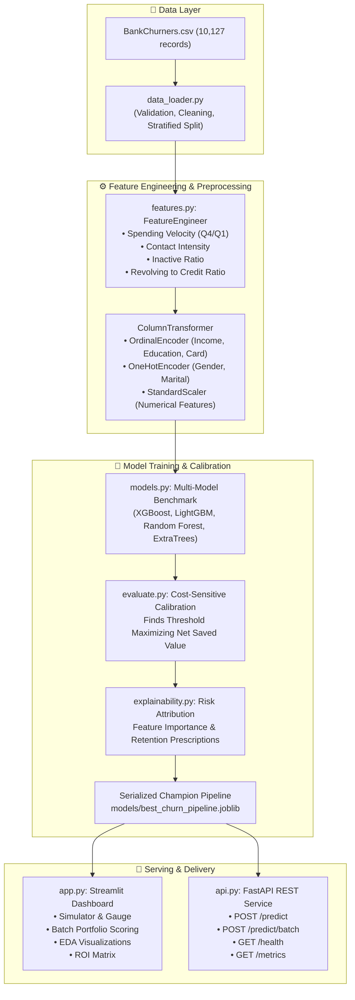

# 💳 Credit Card Churn Intelligence Platform

[](https://www.python.org/)
[](https://scikit-learn.org/)
[](https://streamlit.io/)
[](https://fastapi.tiangolo.com/)
[](https://www.docker.com/)

An enterprise-grade, end-to-end Machine Learning and Decision Intelligence platform designed to identify, explain, and mitigate credit card customer attrition before it happens. Built with modern MLOps practices, cost-sensitive threshold calibration, interactive web dashboard, and high-performance REST APIs.

---

## 📌 Executive Summary & Business Problem

Customer churn in consumer banking and credit cards carries severe bottom-line impact. Acquiring a new credit card customer costs **5x to 7x more** than retaining an existing one. Furthermore:
- The average credit card customer generates **\$1,200 in net Customer Lifetime Value (CLV)** over a 2-year window.
- Churn typically gives **silent warning signals** 3 to 6 months in advance (e.g., sharp drops in transaction frequency, low revolving balances, repeated support contacts, and declining credit utilization).
- Without proactive intelligence, banks discover churn only after the customer cancels or destroys their card.

This project delivers a complete predictive intelligence engine that:
1. Detects customer attrition risks with **>93% ROC-AUC** and high recall on the minority churn class.
2. Calibrates decision thresholds based on **real banking economics** (balancing the cost of outreach vs. the saved CLV).
3. Deconstructs each customer's unique churn drivers and generates **actionable, personalized retention interventions**.
4. Provides a user-friendly **Streamlit Executive Dashboard** and **FastAPI Microservice**.

---

## 🏛️ System Architecture



---

## 📂 Project Structure

```
credit-card-churn-intelligence/
├── BankChurners.csv                                  # Raw bank customer dataset (10,127 records)
├── credit_card_churn_intelligence.ipynb              # Exploratory data analysis & prototyping notebook
├── output-2.html                                     # Data profiling report
├── credit-card-churn-intelligence.pkl                # Serialized model artifact
│
├── config/
│   ├── __init__.py
│   └── config.py                                     # Global constants, paths, thresholds, and financial parameters
│
├── src/
│   ├── __init__.py
│   ├── data_loader.py                                # Safe CSV loading, schema verification, stratified splitting
│   ├── features.py                                   # Domain feature engineering & ColumnTransformer pipelines
│   ├── models.py                                     # Model factory (XGBoost, LightGBM, Random Forest, etc.)
│   ├── train.py                                      # End-to-end training, cross-validation & artifact export
│   ├── evaluate.py                                   # Metrics computation (ROC-AUC, PR-AUC, F1) & ROI calibration
│   ├── explainability.py                             # Feature importances & rule-based customer risk prescriptions
│   └── predict.py                                    # High-performance single and batch inference engine
│
├── models/
│   ├── best_churn_pipeline.joblib                    # Complete self-contained production pipeline
│   ├── model_metadata.json                           # Metrics, optimal threshold, top features, creation timestamp
│   └── metrics_summary.json                          # Candidate model benchmark comparison
│
├── app.py                                            # Interactive Streamlit Web Application
├── api.py                                            # Enterprise FastAPI REST service
│
├── tests/
│   ├── __init__.py
│   ├── test_data.py                                  # Data integrity and schema tests
│   ├── test_features.py                              # Feature engineering transformer tests
│   ├── test_pipeline.py                              # Inference engine and output schema tests
│   └── test_api.py                                   # FastAPI endpoint integration tests
│
├── docker/
│   ├── Dockerfile                                    # Production multi-stage Docker container
│   ├── docker-compose.yml                            # Orchestration for Streamlit (8501) and FastAPI (8000)
│   └── .dockerignore
│
├── scripts/
│   ├── run_training.sh                               # Quick shell script to retrain models
│   ├── run_app.sh                                    # Quick shell script to launch Streamlit UI
│   └── run_api.sh                                    # Quick shell script to launch FastAPI API
│
├── requirements.txt                                  # Pinned Python package dependencies
├── setup.py                                          # Packaging setup configuration
├── .gitignore                                        # Standard Python/IDE ignores
└── README.md                                         # Comprehensive documentation
```

---

## ⚡ Quickstart Guide

### 1. Prerequisites & Environment Setup
Clone or navigate into the project directory:
```bash
cd credit-card-churn-intelligence
```

Create a virtual environment and install dependencies:
```bash
python3 -m venv venv
source venv/bin/activate
pip install -r requirements.txt
```

### 2. Train the Machine Learning Pipeline
To execute the multi-model benchmark, evaluate cross-validation scores, calibrate the decision threshold, and export the trained artifacts:
```bash
bash scripts/run_training.sh
# or directly:
python3 src/train.py
```

### 3. Launch the Interactive Web Dashboard
Run the Streamlit application:
```bash
bash scripts/run_app.sh
# or directly:
streamlit run app.py
```
Open your browser at **[http://localhost:8501](http://localhost:8501)** to explore:
- **Customer Risk Simulator**: Tweak individual customer features and view real-time churn probability, gauge meters, and actionable retention recommendations.
- **Portfolio Batch Analytics**: Score hundreds of customer accounts at once, filter high-risk cohorts, and download prioritized retention lists.
- **Exploratory Insights (EDA)**: Interactive distribution plots for transactions, revolving balances, and support contacts.
- **Model Performance & ROI**: Threshold tuning slider, ROC/PR metrics, and financial savings calculator.

### 4. Launch the REST API Service
Run the FastAPI microservice:
```bash
bash scripts/run_api.sh
# or directly:
uvicorn api:app --host 0.0.0.0 --port 8000 --reload
```
Interactive Swagger documentation is available at **[http://localhost:8000/docs](http://localhost:8000/docs)**.

---

## 🌐 REST API Specification

### `POST /predict`
Predicts churn risk for a single customer.

**Sample Request Body:**
```json
{
  "Customer_Age": 54,
  "Gender": "F",
  "Dependent_count": 3,
  "Education_Level": "Uneducated",
  "Marital_Status": "Married",
  "Income_Category": "Less than $40K",
  "Card_Category": "Blue",
  "Months_on_book": 36,
  "Total_Relationship_Count": 2,
  "Months_Inactive_12_mon": 3,
  "Contacts_Count_12_mon": 4,
  "Credit_Limit": 1438.3,
  "Total_Revolving_Bal": 0.0,
  "Total_Amt_Chng_Q4_Q1": 0.45,
  "Total_Trans_Amt": 1200.0,
  "Total_Trans_Ct": 24,
  "Total_Ct_Chng_Q4_Q1": 0.40
}
```

**Sample Response Body:**
```json
{
  "churn_probability": 0.8924,
  "predicted_status": "Attrited Customer",
  "is_churn": true,
  "decision_threshold": 0.35,
  "risk_tier": {
    "tier_code": "CRITICAL",
    "label": "Critical Risk",
    "badge": "danger"
  },
  "urgency_level": "CRITICAL: Immediate Senior Outreach Required within 24 Hours",
  "key_risk_drivers": [
    "Low transaction frequency (24 transactions/year; active median is ~68).",
    "Substantial drop in quarterly spending velocity (Q4/Q1 transaction change: 0.40).",
    "Elevated support contacts (4 calls in 12 months), signaling customer friction.",
    "Extended account inactivity (3 months inactive in past year).",
    "Near-zero credit card utilization (<5%), indicating customer is migrating spend to competitors."
  ],
  "positive_signals": [],
  "prescribed_retention_actions": [
    "Trigger 'Swipe & Win' 5x reward points campaign on everyday merchant spend.",
    "Send immediate personalized merchant discount offers in dining & travel categories.",
    "Initiate proactive outbound concierge call from senior relationship manager.",
    "Offer 90-day 0% APR promo or fee rebate upon card reactivation.",
    "Offer competitive balance transfer rate or temporary credit limit increase."
  ]
}
```

---

## 🐳 Docker Deployment

Run both the Web UI and REST API seamlessly with Docker Compose:

```bash
cd docker
docker-compose up --build
```
- **Streamlit Web Dashboard:** [http://localhost:8501](http://localhost:8501)
- **FastAPI REST API:** [http://localhost:8000](http://localhost:8000)
- **API Swagger Docs:** [http://localhost:8000/docs](http://localhost:8000/docs)

---

## 🧪 Automated Testing

Execute the unit and integration test suite with `pytest`:
```bash
pytest -v tests/
```

Coverage includes:
- Data loading and column drop assertions
- Feature engineering mathematical verification
- Single customer & batch inference schema validation
- FastAPI endpoint health and routing checks

---

## 💰 Banking Financial ROI Calibration

Standard machine learning models default to a `0.50` decision threshold. However, in banking churn:
- **Cost of False Negative ($FN$):** An unaddressed customer churns, resulting in a loss of **\$1,200** in CLV.
- **Cost of False Positive ($FP$):** An outreach campaign is sent to a customer who wouldn't have churned, costing **\$60**.

This asymmetric 20:1 cost ratio implies the bank should intervene even when churn probability is **30%–35%**.

The Net Business Saved Value is calculated as:
$$\text{Net Value} = TP \times (CLV \times \text{Retention Rate}) - (TP + FP) \times \text{Campaign Cost}$$

By calibrating the threshold using `src/evaluate.py`, the system maximizes net saved revenue across the customer portfolio.

---

## 👨‍💻 Author

<div align="center">

<a href="https://github.com/iitking">
  
</a>

### **Nivesh Kumar Meena**

**AI Architect · MLOps Engineer** | B.Tech Electrical Engineering, **IIT Roorkee**

*Building agentic AI systems, RAG pipelines and production-ready ML.*

<a href="https://www.linkedin.com/in/nivesh-kumar-meena-a31465221/"></a>
<a href="https://github.com/iitking"></a>
<a href="mailto:niveshkr149@gmail.com"></a>

<br/><br/>

⭐ **If you found this project useful, please give it a star!** ⭐

<sub>Open to AI/ML engineering opportunities and collaborations.</sub>

</div>

---

<div align="center">
  <sub>Made with ❤️ by <a href="https://github.com/iitking">Nivesh Kumar Meena</a> · © 2026 · MIT License</sub>
</div>

